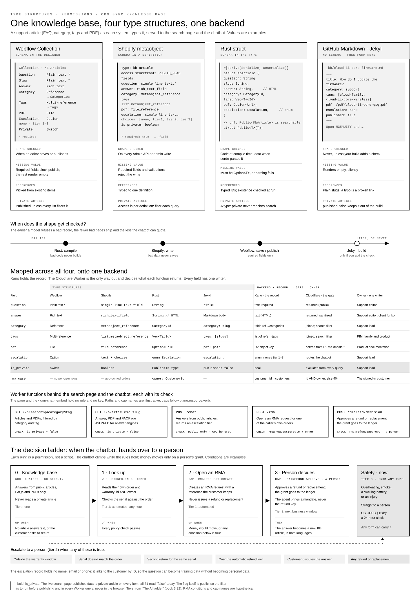

# Build Over Buy

**Read the full playbook: [Build Over Buy](https://claude.ai/artifact/3ooeS962TpwgeQh1A8HJWX)** (English and Korean).

**Related articles:** [ECC cutover: ECC direct to Google](https://ecc-rust-book.yoonsunlee150.workers.dev/ecc-direct-to-google) · [ECC to S/4HANA cutover checklist](https://crm-sync.dev/ai-cutover-checklist) · [PIM Sync](https://www.crm-sync.dev/pages/pim-sync) · [Migrate from Gadget to PIM Sync](https://www.crm-sync.dev/pages/pim-sync#pim-sync-migrate-from-gadget) · [Klaviyo migration](https://crm-sync.dev/products/klaviyo-data-migration) · [AI task runner (Claude Tool Runner)](https://platform.claude.com/docs/en/agents-and-tools/tool-use/tool-runner)

**Security:** [Xano claims and extras](https://docs.xano.com/building-backend-features/user-authentication-and-user-data/separating-user-data) · [Xano entitlements](https://docs.xano.com/building-backend-features/user-authentication-and-user-data) · [Shopify and SAP: Domain Is Not Identity](https://claude.ai/artifact/GXu85VqcrEkDRKpiLJxwBJ) · [Definitions: short token, long-run data stream, TLS](TRUST-VOCABULARY.md)

Shopify public apps that still use non-expiring offline tokens are delisted on 1 January 2027, and their Admin API calls fail with 403 from 1 April 2027. The playbook uses that deadline as the moment to move off fee-based plugins to a build on Cloudflare, Xano and Webflow, one vendor at a time, with each vendor's history mirrored first.

## What it covers

- **The deadline and the migration:** what breaks on 1 January and 1 April, and the IP allowlist dates for public apps.
- **Key rotation and the key ceremony:** how keys rotate between Cloudflare (Worker secrets, KV, signing keys) and Xano (console keys, Auth Me, entitlements), with a diagram.
- **Why some credentials break against Shopify:** a `.env` file on disk, an SAP permanent token or Salesforce long-lived auth, and when middleware such as SAP CPI or MuleSoft handles client credentials fine.
- **Bindings instead of keys:** Cloudflare's binding model, React Router 7 passing bindings to loaders, and why classic Prisma's compiled engine didn't fit Workers.
- **Race conditions in a 15-minute middleware cycle,** and idempotent Xano functions as the fix.
- **Data layer and EDI:** why a sync can return 200 and still be broken, each EDI document (846, 850, 855, 940, 945, 856, 997) against its closest Shopify equivalent, a one-way scheduled feed such as Rithum versus event hooks that depend on permissions, and the signs a plugin, ERP or CRM sync has already stopped working.
- **HTMLRewriter and serde for business analysts:** brand.com and a translation-plugin subdomain uk.brand.com as the example, one page rewritten per market as it's delivered, a check on every data package, and sign-in and app callbacks to brand.com only.
- **One Worker in front of any origin:** Webflow, Magento, WordPress and WooCommerce, EmDash or a headless front end. The same code with a per-origin config: selectors, hosting in front (Adobe Commerce Cloud's Fastly, managed WordPress CDNs, hosts that won't take a proxy), checkout and account paths left unrewritten for PCI, cookies and cache, CSP, market mapping and non-expiring tokens.
- **PTA Shopify vs Big Boy Pants Data:** the Zapier and Salesforce-plugin chain to SAP ECC and how it fails, Airtable as fine for a small catalog (under about 2,500 calls a sync), Shopify's rate-limit ceiling by plan, a field note on morning 404s while an ERP batch outran the bucket, and what Xano-level data handling changes.
- **Old is new again:** HBO GO's crash at the Game of Thrones season 4 premiere (6 April 2014) and why thread-per-request designs fail on launch night; the Node preload strategy; Rust threads and async (Tokio, Rayon, backpressure) and async data-loading improvements; and the Polymer-era Shadow DOM polyfill and data binding mapped onto MVC with AI, Cloudflare, Xano and tool and rule runners.
- **Consent, regulation by market, Korea, CRM platforms, ERP, and the Merchant API v1 migration.**
- **What's built:** one dated checklist of what runs in production and what's still open.

## Related

- [Middleware vs AI Architecture](MIDDLEWARE-VS-AI-ARCHITECTURE.md)
- [Shopify Expiring Token Management](SHOPIFY-TOKEN-MANAGEMENT.md)
- [Decision ladder spec](RMA-LADDER-SPEC.md)
