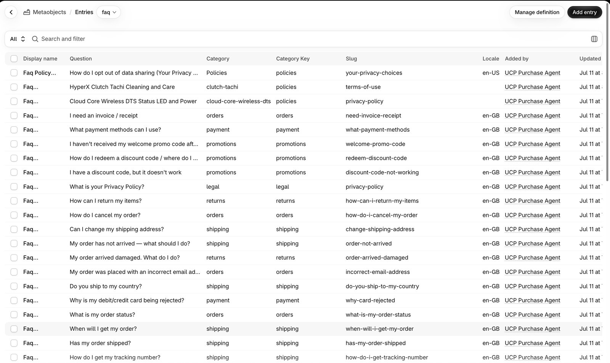

## Thank you first

Every app we ship is built on someone else's good ideas. PIM Sync is no exception.

- **The Remix team**, whose loaders and actions became **React Router 7**, the framework behind Shopify's own app template and Hydrogen.
- **Vite**, for a build that does exactly what the source says, in the order it says it.
- **Gadget**, and **Webflow with Wized**, for showing how fast a data app can come together. They are still great ways to build one.

## The same problem on Shopify

Both ran into the same problem on Shopify, and it is not a flaw in either tool. Shopify's own documentation says its storefront content delivery network is "backed by Cloudflare" ([Shopify: performance on the platform](https://shopify.dev/docs/storefronts/themes/best-practices/performance/platform)). An app whose data lives on Google Cloud or Firebase works, but every Shopify call then crosses from one cloud to another, and moving e-commerce data that includes personal (PII) or payment (PCI) data between clouds gets harder each year.

Two Shopify changes make it sharper:

- **IP allowlists.** Shopify now requires public apps to call it from listed IP ranges, enforced from November 20, 2026. The allowlist takes IP addresses, not a network's ASN, so an app on a shared cloud has to keep its ranges current, and every other cloud in the path is one more list to keep.
- **Short-lived tokens.** Offline access tokens that never expire are being retired; public apps still using them are delisted on January 1, 2027. Expiring tokens have to be refreshed and stored safely wherever the app runs, so each cloud that holds one is another place a token can leak or go stale.

Keeping the app, its tokens and its data on Cloudflare and Xano, in the market the data belongs to, keeps that path short: one network that already sits in front of Shopify, and one data layer with a home region.

A year ago the same cross-cloud path carried less risk. AI has made development faster, and it has made attacks faster too: the same tools that write an integration in an afternoon can probe one just as quickly. So when data crosses channels, from Shopify to an app, from one cloud to another, from a store to an agent, encryption is mandatory, not a setting, and the token timeline needs a strategy of its own: how long each token lives, where it is stored, who refreshes it and what happens when it expires.

Many of the plugins we are used to adding will no longer be needed. When the data is modeled securely from the start, with every hop over TLS between Cloudflare and Xano, permission rules on the rows and keys kept server-side, the jobs those plugins did, such as moving data, guarding it and syncing it between tools, are already done by the stack.

## Built just before AI

Those tools came just before AI could live next to the data. Since Cloudflare's Workers AI binding arrived in 2023, a model runs in the same Worker as the request, beside KV and R2, instead of being a call out to another cloud.

So we kept the methods and extended them, in partnership with AI:

- **React Router 7 on Cloudflare**, with no server to scale or patch. Sessions live in Cloudflare KV, assets in R2.
- **Xano as the system of record**: OpenAPI (Swagger) documentation for every API group, Docker and Kubernetes through Xano Enterprise, and entitlement claims in auth token extras, checked by a Cloudflare Worker at the edge.
- **AI tasks and tool calls**: Xano tasks run model jobs on a schedule, and Xano tools let an AI agent call your endpoints under the same entitlement claims as any other request. Translation, quality scoring and agent access run where the data already is.
- **Consent before any tracking**: Vite builds a fixed load order (consent script first, tracking only after consent, CSS before GSAP), tested on every release.

## OpenRouter, or a model bound to the data

OpenRouter is a great answer to a real problem: one API and one bill for hundreds of models from many providers, with routing and fallback between them. If you need the widest choice of frontier models, it is hard to beat.

PIM Sync answers a different question: which model should touch this merchant's data, and under which rules?

- **Where the model runs.** With OpenRouter, the request leaves your app for OpenRouter and then for the provider it routes to, each with its own data policy. With a Workers AI binding, the model is called inside the same Cloudflare Worker that already holds the request, next to KV and R2, with no API key in the code.
- **How the choice is made.** OpenRouter picks a provider per request by price, speed or availability. PIM Sync lets each merchant set the order per language (reuse a reviewed translation, Meta's m2m100, Alibaba's Qwen3, then keep English), and a model's answer is kept only if it passes the quality checks and its bge-m3 meaning score reaches the merchant's minimum.
- **What the model may see.** A gateway passes along whatever the app sends. Here, data reaches a model only after the permission checks have run.
- **Breadth.** Workers AI offers a smaller, open-model catalog. When a job needs a frontier model, Cloudflare AI Gateway can reach outside providers from the same Worker, with the same rules in front of it.

[How does PIM Sync handle model weight and regional LLMs?](https://www.crm-sync.dev/pages/pim-sync#features-translation-models)

## Knowledge base segments, with nested rules

*CRM Sync, not PIM Sync: FAQ rows published to Shopify as metaobjects, each with its category key, slug and locale.*

A knowledge base for AI is only safe if each answer comes from rows the asker may see. CRM Sync segments its knowledge base the way it segments customers: identity, then consent, then entitlement, then segments. FAQ and article rows carry segments and a locale, and a question only searches rows in the asker's segment and language, so a French answer never bleeds into an English one and a partner-only answer never reaches a shopper.

See it working:

- [Knowledge base search demo](https://omenphase1-1.webflow.io/knowledge-base-search)
- [Chatbot proof of concept](https://crm.story-story.ai/preview?shop=hx-stage.myshopify.com) (a demo store: you will not be able to purchase)

A global chatbot is where this gets hardest. One widget lives across several Shopify deployments, one per market, and a single conversation can cross a return (RMA), a currency change and a stock check. Each answer touches a different system of record: the ERP for the order and refund, the CRM for the customer and their consent, the WMS for stock and the return label, and the storefront for the price in the shopper's currency. Keeping that answer right, in the right language and currency, for the right market, is only manageable when every system is read through the same segments and rules, not wired to the widget one by one.

LLM automation is what makes the fallbacks practical. Each answer has three ladders, tried in order, and says plainly when it stepped down one:

- **Currency.** The price in the shopper's market currency, from that market's price list; if there is none, the store's base currency, labeled as such. The model never converts a price itself: the number always comes from the record.
- **Measurement.** Sizes, weights and capacities in the shopper's units, from the product's own unit records; if a unit is missing, the source unit, shown as it is.
- **Language.** A reviewed answer in the shopper's language; then a machine translation that passed the quality checks; then English, with a note that it is English.

The model does the wording and the choosing. The records supply every number.

The rules nest. A store's rules sit inside the platform's rules, a team's inside the store's, and an agent's inside the team's, so each level can narrow what the one above allows but never widen it. The same rules decide which tools an AI agent may call: a tool call is one more request, checked against the same entitlement claims before it reaches Xano.

Today PIM Sync's Rust crate, compiled to WebAssembly, enforces the product identity rules Google reads (product group ID, SKUs, check-digit-verified GTINs) at the edge. Rules compiled once in Rust and run as WebAssembly in the Worker are the pattern we are extending to these nested data permissions, so the same compiled rules run wherever the request does.

## Your Xano, in your country

**Bring your own Xano (Plus).** A merchant can connect their own Xano workspace, so the catalog stays in their account. If they leave PIM Sync, the data stays with them.

The same pairing of Cloudflare and Xano meets local data-storage rules market by market, with a Xano instance and Cloudflare settings chosen for each:

- **Korea (PIPA).** Korean personal data stays in a Xano instance hosted in Korea, and Korean identifiers leave the country only through the consent gate. Korea is a prior-consent market: nothing is tracked before the visitor agrees.
- **China (PIPL).** Personal data is stored in mainland China, on an in-country database host, with Cloudflare's China network run through its local partner and an ICP license. This is a dedicated deployment, not a setting.
- **Japan (APPI).** An Asia-region or in-country Xano instance, with the transfer basis documented for anything that leaves Japan.
- **Germany (GDPR and BDSG).** An EU-region Xano instance and Cloudflare's Data Localization Suite for processing and storage.

Each market's rules are checked by tests, so a release cannot quietly break them. Today those cover Korea's prior-consent rule and the Korean knowledge base; China, Japan and Germany get theirs as each deployment goes live.

**Knowledge base fallback, curated.** When a question in Korean has no Korean answer, the knowledge base searches Korean content first, then falls back to English and says that it did, instead of guessing or mixing languages. Translated answers are curated per market, so each region's knowledge base carries only the answers reviewed for it.

## Curated, not blanket AI

The easy path is AI applied across everything: one model, every row, every user. We take the opposite path. Content, security and permission rules are tuned on purpose, built from a curated structure:

- **Models, views and controllers** that keep data, presentation and actions apart, so each can be checked on its own.
- **Tags** that are records, not strings: each one carries its key, its kind and its meaning, so content can be filtered and joined on it.
- **Joins** that decide what an answer may draw on: product to market, customer to consent, role to entitlement.
- **A component publish system**, where each component is published to its channel by the role that owns it, with its rules attached.

All of it is tailored to stakeholder roles. A merchandiser, a compliance lead, a developer, a partner and an AI agent each see the content, tools and controls their job needs, and nothing more.

It is built for and with design-first principles of utility: every screen, rule and tool call has to make someone's job simpler, or it does not ship.

Here is what that utility looks like. A small business in Korea can work effectively with a small creative agency in a small town in the USA. The agency writes the product copy and designs the pages in English; the owner reads the Korean translation, fixes any wording by hand and approves it before it reaches the store. Both work on the same catalog rows, each in their own language. Neither needs an enterprise team, an interpreter or a developer to stand between them, and each sees only the content, tools and controls their role needs.

## A pathway to success: discover, build, deploy

- **Discover.** Map the stakeholder roles, the data each one owns and the rules each market imposes, before any model is chosen.
- **Build.** Model the data in Xano, tag and join it, write the permission rules, and pick the AI model for each job: a model bound to the data where it can be, a gateway to a frontier model where it must be.
- **Deploy.** Publish component by component, on Cloudflare, with consent loaded first and every rule tested on every release.

## Concept, review, publish: nothing destructive

Most developer tooling assumes a computer-science background: branches, migrations, build pipelines and rollback commands, each one a way to break something in production. This stack is built so the people who own the content can work safely without that training. Every change moves through three steps, and none of them overwrites what is live until someone says so:

- **Concept.** Changes start as drafts beside the live version: a preview deployment, a Xano branch, a draft post, a machine translation waiting in the queue. The live store, page or catalog is untouched.
- **Review.** Each change is shown as it will appear before it ships. Translations reach a store only once someone marks them reviewed, pages and posts have a preview, and every publish can run as a dry run first.
- **Publish.** Only then does the change go live, and the version before it is kept, so going back is a step, not a repair.

Review has to test what actually runs, not only how it is configured. In our own consent audit work in September 2026, we withdrew a headline finding after runtime testing disproved what the configuration seemed to show. A setting read on its own is a hypothesis; a test of what the page actually loads, and when, is the evidence. That is why consent load order is tested on every release, not checked once.

Security and scaling come with the stack rather than being added afterwards. Keys stay server-side in Cloudflare and Xano, never in a browser or a content editor. Permission rules run before data reaches a page, a person or a model. Cloudflare runs the app wherever requests arrive, so there are no servers to size and no database migrations between a reviewed change and a published one.

## Migrating from Gadget

Every Gadget part has a counterpart on Cloudflare and Xano, and your Shopify app keeps its app ID, installs and subscriptions. The feature-by-feature map and the six migration steps are on the PIM Sync page:

[Migrating from Gadget](https://www.crm-sync.dev/pages/pim-sync#from-gadget)

## Try PIM Sync Pro: $10 a month for six months

Use code **PRO10** on the Upgrade Plan page in PIM Sync. Pro is $10 a month for your first six months, after the 30-day free trial, then $69 a month. The code is for new monthly Pro subscriptions, once per store.

[PIM Sync on the Shopify App Store](https://apps.shopify.com/pim-sync)
